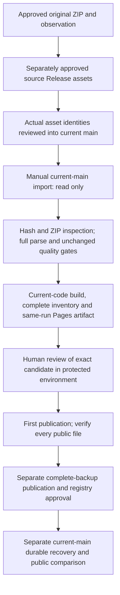

<!--
Purpose:        Define a trusted first import of the user-selected retained October 16 source
Owner:          Architect / Release Manager
Update Trigger: When this design is reviewed, approved, implemented, or operationally exercised
Harness Version: 1.1
-->

# TASK-009 retained-source initial import — 2026-10-20

Status: Source selection approved on October 20; this full design approved by the user on 2026-10-21.
Scope: Design only. No importer, workflow, runtime registry or remote asset is created here.
Requirements: FR-13; supporting FR-02/08/12/14; AC-009-4/5 and existing release gates remain open.

Approval update — 2026-10-21: the user approved this design and requested a detailed
implementation plan with quality criteria unchanged. Upload and deployment are explicitly
withheld. The [implementation plan](../plans/2026-10-21-task-009-initial-import.md) is written
for review; no execution begins from design approval alone. Proposal language below preserves
the original design wording; this dated approval resolves its design-approval gate only.

## Intent and authority

The user approved the exact October 16 retained source for the first publication/recovery
verification exercise and required the existing quality criteria to remain unchanged. The user
requested this initial-import design. That resolves the source-selection question from the
[analysis](../../../reports/research-2026-10-20-task-009-first-publication.md); it does not approve
this new transport/workflow design, its implementation, public source-asset publication, Pages
setup, workflow dispatch, environment approval, backup registration or recurring operation.

Build the first site from the retained original ZIP using trusted current code and the unchanged
approved quality inputs. A separate manual import path supplies the historical source; ordinary
refresh continues collecting live source. Actual successful publication is followed by the
existing complete-site backup and recovery sequence. Never treat a local candidate or a source
archive as a publicly verified recovery snapshot.

## Current implementation constraints

Current main is `b586e72e88cb41b9988a62d70f9cd5b5503b53bc` (merged PR #33).
The preceding analysis and its handoff edits remain uncommitted in the reused calibration
checkout and must be preserved. This design introduces no dependency, service, search behavior,
status/date mapping, public app URL or static runtime architecture change.

- `scripts/stage-refresh.mjs` always invokes the live collector. Its bootstrap flag selects an
  approved initial baseline only after a direct deployed-descriptor 404; it does not select old input.
- `stageBoundedRelease` already accepts trusted collection evidence and a complete category
  iterator. Reuse it with `inspectArchive`, strict CSV parsing and the existing transformer/validator.
- `restore.yml` and `restore-publication.mjs` require an active current-main recovery approval
  backed by successful deployment/public verification. The empty recovery registry must remain empty.
- `validateRecoveryProvenance` currently permits only `.github/workflows/refresh.yml` as the
  originating publication workflow. A separate initial-import workflow therefore also needs a
  narrowly scoped backup-provenance update before the first recovery exercise can succeed.
- The current code has separate default-off schedule/publication flags, protected main-only
  deployment, same-run Pages artifact selection and current-main guards. Preserve all of them.

## Exact approved source and unchanged quality identity

| Binding | Required value |
| --- | --- |
| Repository / proposed source ID | `internalforces/open-store-searcher` / `seoul-2026-10-16-initial` |
| Raw ZIP SHA-256 / bytes | `c90758c2d3922e78d636ab2c9967b80c690bdcd8aeca283cf9f6ecc2cc992352` / 217,307,219 |
| Original collection instant | `2026-10-16T01:52:52.043Z` |
| Source coverage / category count / rows | null / 195 / 2,951,024 |
| Archive schema-manifest SHA-256 | `6254a2b3d6626c41f625bb98d79399bdd40318632ce0d54561a997fdd039ceb6` |
| Original observation file SHA-256 / bytes | `3d23a3c770b24039a6690f2db8022eb610ffb5b56a9efee031f78b78918b4626` / 356,005 |
| Canonical original collection object SHA-256 / bytes | `3817b6e8d7621c12c7ce4a3b5ae8c581c28340284ec001737900a2744d6ac22b` / 629 |
| Policy revision | `task-008-calibration-2026-10-16-v1-proposed` |
| Canonical policy SHA-256 | `090973f79398f45d52262958e2887497652cec13b4d95b608eb84c691070feff` |
| Canonical initial-baseline SHA-256 | `9234ed3297166a08b500356ac01f5bcd150276c04a2bdd129d399fa0bdc6b183` |
| Canonical reviewed-pair-contract SHA-256 | `d698ac34c7485c9e09dfec425a0195bcc56d9644f25479aefc350c5969998cb2` |

The observation bytes are the committed
[`observation-2026-10-16-bounded-source.json`](../../../reports/observation-2026-10-16-bounded-source.json).
Its collection object records the historical provider acquisition. Preserve it; transport from
GitHub is a later import, not a second provider acquisition. Ignore its legacy research dataset
size when enforcing the production compact JSON budget.

Canonical object hashes mean Node.js 24.19.0 `JSON.stringify(object)` UTF-8 bytes, with no newline.
File hashes above bind actual file bytes. Do not substitute another language's numeric JSON
serialization or confuse the canonical initial baseline with the generated `baseline.json` file.
Both production and validation configurations must retain deeply equal `policy`, `baseline` and
`reviewedUnverifiedPairs` objects and the approved 23-ID empty list. Retain the `-proposed` revision
suffix. Keep `maxJsonBytes=691319965`, `maxEntryBytes=536870912`, `maxTotalRows=3000000` and
`entryTimeoutMs=120000`; no automatic growth tolerance, fallback policy or rebasing is introduced.

The ZIP was rehashed in place on October 20 and matches its exact approved length/digest.
The previous full accepted source replay and all-file package proof remain dated evidence;
fresh import verification is still mandatory. Original collection age is four Seoul calendar
days on October 20; the age-seven warning begins October 23. A later import/build date cannot
reset age. Age warnings remain warnings; this design introduces no new expiry waiver or rule.

## Proposed transport and alternatives

Architect's proposed choice: transport the exact ZIP and original observation as two assets on
a separately approved published GitHub Release in this same existing public repository. This
reuses GitHub and the existing bounded unauthenticated resource reader. It adds no service,
dependency, credential, self-hosted runner or workflow write permission.

Proposed tag: `initial-source-seoul-2026-10-16`. Proposed asset names:
`seoul-source-2026-10-16.zip` and `source-observation.json`. The observation asset is an exact byte
copy of the committed file above, not a regenerated receipt. This release distributes source
input only and must be labeled accordingly; it is neither a product release nor a recovery backup.
Its creation is a distinct public-data/tag/asset action requiring concrete approval. Confirm the
applicable existing attribution/redistribution evidence and account/resource allowance first;
this design makes no claim about uninspected account capacity or a future upload's success.

Actual release ID, immutable asset IDs and the tag's peeled commit do not exist yet and are not
invented here. After separately authorized upload, read back metadata, redownload both assets and
verify exact bytes. A later reviewed protected-main change records those real identities before
hosted import is possible. Tag/filename/digest supplied by a dispatch are never sufficient authority.
No mutable "latest" release or provider URL is an input.

Alternatives considered: committing the large source into Git history adds an unnecessary source
blob; trying to refetch the mutable live URL cannot promise the selected archive; reusing a local
site tar skips trusted source reconstruction and has no successful recovery provenance; adding
a self-hosted runner or new object store expands infrastructure. A local import mode is useful
for private verification but does not by itself deliver bytes into the hosted workflow.

## Trust records and data contracts

Proposed runtime trust root: `publication/initial-import-approvals.json`. Implementation initially
creates an inactive registry with version 1, kind `initial-source-approvals`, the exact repository
and site URL, `activeSourceId:null` and `sources:[]`. No active source entry is installed merely
because its source selection is approved. Design/implementation approval and later transport
binding/delivery are separate actions.

A populated entry is a strict, extra-field-rejecting data record with these fields:

| Field | Contract |
| --- | --- |
| `id`, `purpose` | Exact source ID above; purpose `initial-publication-recovery-verification`. |
| `archive`, `observation` | Exact `{byteLength,sha256}` bindings in the table. |
| `collectionCanonicalSha256`, `collectedAt`, `sourceDataAsOf`, `recordCount`, `categoryCount` | Exact selected historical values; null coverage remains null. |
| `schemaManifestSha256`, `policyRevision`, `policyCanonicalSha256`, `baselineCanonicalSha256`, `reviewedPairsCanonicalSha256` | Exact approved contract identity; no revision wildcard. |
| `releaseId`, `tag`, `tagCommit` | Actual positive safe-integer ID, exact proposed tag, actual 40-hex peeled target approved after upload. |
| `assets.archive`, `assets.observation` | Actual positive asset ID, exact proposed name, length and SHA-256 for each role. |

The enclosing registry binds the fixed site
`https://internalforces.github.io/open-store-searcher/` and repository. It accepts exactly the
selected active source ID, never an arbitrary entry supplied by downloaded data. Invalid/null
IDs, replaced tags/assets, duplicate role names/IDs, mismatched repository or inactive registry
fail before materializing source. Asset hashes are independently fixed by source approval,
not vouched for by their own downloaded metadata. Downloaded observations never grant authority.

Proposed trusted adapter: `scripts/stage-initial-import.mjs CONFIG REGISTRY SOURCE-ID NEW-OUTPUT`.
Its fixed workflow passes only the source ID through a quoted environment variable. Config and
registry paths are literals from current main. No URL/path/command/policy/date overrides or
live-collector fallback are accepted. A local verification variant takes an existing read-only
ZIP and observation path while enforcing the exact same source record/quality checks; it cannot
claim hosted transport, dispatch, artifact or deployment evidence.

The import receipt is a new data kind, `retained-source-import-verified`, binding original source
identity, historical observation digest, current transport asset identities, acquisition/check
timestamps and current operator SHA. It records the actual validation clock independently.
Do not manufacture a new provider-collection receipt or reuse the recovery-provenance kind.
The adapter derives the staging-only accepted collection input from the hash-bound historical
observation, substitutes only the verified local ZIP path and retains original `fetchedAt` and
provider evidence. Fresh ZIP inspection must equal the historical schema/count/date evidence.
The receipt explicitly states that this is a verified retained import, not a live collector run.

## Flow and failure behavior

1. Check pinned Node/npm, existing Linux Info-ZIP environment, current executable root and exact
   config/registry/source/contract bindings before network or parsing. Local files must be owned
   regular inputs without symlinks; use existing safe operator-read/transaction conventions.
2. Require a fresh direct `release.json` HTTP 404 at the fixed deployed URL. A descriptor already
   present, redirect, denied request, malformed response or uncertainty aborts initial import.
   Never fall back from normal refresh or recovery into this path. Recheck 404 before final
   preparation promotion to catch a competing publication while the large source is processed.
3. Read same-repository Release/tag/asset metadata; verify peeled tag target and both asset roles.
   Download by immutable asset ID using existing bounded `readRecoveryResource` behavior, without
   credentials. Binary 200/302 handling retains the existing HTTPS host allowlist, no credentials,
   bounded redirects, inactivity/deadline, cancellation and streamed hashes. Source ZIP maximum
   is its exact 217,307,219-byte length; observation maximum is its exact 356,005-byte length;
   metadata remains within the existing 1 MiB bound. Verify final length/hash and read back
   metadata after downloads. No replacement, truncated transfer or provider retry is adopted.
4. Parse the hash-bound observation with strict UTF-8. Require its original collection object,
   schema and source identity to equal the approved bindings, then rerun `inspectArchive` with
   current permission/schema contracts and approved collector inspection limits. Preserve current
   ZIP integrity/name/category/header/timestamp checks; importing retained input does not bypass them.
5. Stream all 195 entries via current `iterateLicenseCsv` into `stageBoundedRelease` under unchanged
   resource/quality settings and the actual current clock. Rehash the ZIP before and after.
   Require accepted quality with only applicable source-coverage/collection-age warnings and exact
   measured metrics equal to the selected initial baseline. Keep all rows, identifiers, raw
   statuses and approved unknown pairs. No observation-mode output is a publication candidate.
6. Build with `build-publication.mjs` from this fresh accepted stage; inspect with
   `inspect-publication.mjs`. Record exact current-code SHA, release/manifest/generated-baseline,
   tar and inventory bindings plus original collection identity. Enforce actual compact JSON and
   full-site size guards. The old 730-file package is reference evidence, not the new artifact.
7. Produce one complete owned output only after validation, build, inspection and the final 404
   check succeed. Partial files stay in operation-owned scratch and are removed on failure.
   Existing inputs/output/site/approved baseline/registries remain untouched. Recheck main before
   uploading the same-run tar and a distinct `initial-import-metadata` artifact (receipt, identity,
   inventory and before-publication precondition); retain both for the existing one-day window.
8. After exact action-time deployment approval, the protected deploy job rechecks current main,
   the recorded direct 404 precondition and same-run candidate/metadata identity before publishing.
   No environment auto-approval or publication flag change occurs inside the workflow. A stale
   run, changed public state or expired artifact requires a new authorized preparation; it never
   recollects silently, uses another archive or reinterprets an old successful run.

The importer never loads code from source/observation/Release contents. It writes no production
baseline independently: generated `baseline.json` belongs to the same atomic site artifact.
Any failed or uncertain public result requires public/deployment reconciliation before another
action. No success, baseline advancement or last-known-good claim is inferred from a job label.

## Workflow boundaries and permissions

Propose `.github/workflows/initial-import.yml`, with only `workflow_dispatch` and one `source_id`
input validated against the active current-main record. It has no schedule, push, pull-request or
workflow-run trigger. Require default main in job predicates and current-main identity before
preparation artifact upload and again after environment approval. Use the existing shared
`pages-publication` concurrency group with `cancel-in-progress:false` across refresh/import/restore.

Prepare has `contents:read` only, no protected environment and no write token. It runs existing
pinned full verification and applicable Node packaging/operator checks plus new importer checks
before trusted import/build/inspection. Reuse existing pinned action identities. It needs no
new action, package, `contents:write`, custom secret or expanded runner infrastructure.
Only deploy has the existing `contents:read`, `pages:write`, `id-token:write` permissions and
the unchanged protected `github-pages` environment. Retain main-only deployments, required human
review and no administrator bypass; re-read actual settings at action time rather than trusting
a dated record. Secrets and token contents must never appear in receipts/logs.

For preparation only, leave publication disabled; the deploy job skips and is not queued later
by changing a variable. For an authorized single run intended to wait for exact candidate review,
set the existing publication flag before dispatch, keep scheduling disabled, allow prepare to
finish, and stop at the pending environment job. Approval of the run/candidate is separate from
source selection. Reset one-time publication enablement afterward or on preparation failure.
No recurring preparation or first-publication reuse becomes authorized by this design.

## Successful-publication transition into recovery

After independently verified successful first deployment, reconcile every expected public file
and descriptor-before/after using current code. Check subpath/Worker loading, search, raw and
processed statuses, attribution, original collection date, coverage warning and age behavior.
Keep the original tar, complete inventory, actual run/artifact/deployment IDs and operator SHA.

Propose allowing exactly two origin paths in `validateRecoveryProvenance`:
`.github/workflows/refresh.yml` and `.github/workflows/initial-import.yml`. Update operator docs
and meaningful provenance/CLI tests with that exact closed set; arbitrary/PR/restore workflow
paths remain rejected. This changes origin-path admission only. All independent successful
deployment-history, public-equality, asset/hash, date, same-repository and current-main registry
requirements remain mandatory. Existing refresh backups retain their meaning.

`sourceCommit` and `workflowCommit` for the first complete-site backup describe the actual
current-main build/publication run, not the older source transport tag or historical collection
implementation. Preserve historical source evidence separately in the import receipt. Only after
separate exact backup tag/asset approval, redownload equality and independent provenance/history
review may a current-main recovery registry entry be adopted. Source transport assets never enter
that registry. Then perform separately authorized durable restoration through `restore.yml` and
verify all public bytes without relying on the original one-day Actions artifact. No invalid
candidate or intentionally corrupted public site is needed for this recovery exercise.

## Acceptance and verification matrix

| ID | Required evidence | Requirement |
| --- | --- | --- |
| II-01 | Exact selected ZIP/observation, canonical collection/quality hashes and inactive/active registry admission; mismatch and extra-field rejection. | FR-02/08/13 |
| II-02 | Same-repository IDs/tag target and duplicate/replaced/oversized/truncated/redirect/cancellation failures, with no accepted output or leaked URLs/credentials. | FR-08/13; security |
| II-03 | Full 195-category parsing, identity/collision and reviewed-pair handling; exact 2,951,024 rows/initial-baseline metrics; unchanged quality/empty/resource inputs. | FR-08/13 |
| II-04 | Original collection/null coverage preserved; actual import clock separate; warning at October 23 Seoul midnight; import time cannot refresh the data. | FR-12/14 |
| II-05 | Wrong existing output, source mutation, interruption, incomplete category, rejected quality, compact/site-byte failure and build/promotion failure preserve complete prior inputs/site and remove only owned scratch. | FR-13 |
| II-06 | Fresh bootstrap 404 before/final preparation and after approval; existing/corrupt/denied/redirected/uncertain state and stale main reject. | AC-009-4/5 |
| II-07 | Actual composed CLI wiring, fixed registry/config paths, quoted scalar input, manual-main-only workflow, minimal permissions, schedule hold, shared concurrency and exact same-run tar/metadata bindings. | FR-13; Actions security |
| II-08 | Fresh complete-source raw import/build/inspection proof and full inventory; failing input never becomes a candidate. | FR-02/08/13 |
| II-09 | Closed two-path successful-backup origin admission; all prior provenance/public/history/registry checks intact; source assets cannot become recovery authority. | FR-13 |
| II-10 | Separate hosted first publication/public equality, durable complete backup/redownload/adoption and expired-original-artifact recovery evidence. | AC-009-4/5; TASK-009/010/021 |

Implementation verification includes focused meaningful rejection/integration tests, unchanged
`npm run verify:full`, existing four-file Node operator/packaging checks extended as needed,
independent whole-diff review and Actions/security review for the new entry point and narrow
provenance change. Do not claim II-10 from unit fixtures, local import or CI. Physical/mobile/
hosted full-data performance and applicable release prerequisites remain before actual first
deployment. No performance exception or v1.0/milestone acceptance is implied.

## Delivery boundaries, approval sequence and builder choices

| Stage | What is authorized now / what still needs approval |
| --- | --- |
| Source | Exact October 16 source selection and unchanged quality are approved. |
| This design | Written design and builder check only; architecture/workflow/transport details proposed. |
| Implementation | After full-design approval, write the detailed implementation plan; no product code before that approval. |
| Code delivery | Exact commit/PR/protected-main integration retains separate authorization. Preserve prior local analysis. |
| Source transport publication | Present exact tag target, both public asset names/lengths/hashes and attribution/resource evidence before tag/Release/upload; record/redownload actual IDs afterward. |
| Transport trust-root adoption | Present exact real source-entry bindings and protected-main delivery separately; no fabricated IDs or automatic activation. |
| Remote setup and preparation | Re-read protections/public state; obtain concrete Pages setup/variable and one-time dispatch approval. |
| First deployment | Exact operator/config/run/artifact/inventory/URL plus fresh absence and prerequisites; separate environment action-time approval. |
| Complete backup and recovery | Exact complete assets/history and registry adoption, then separate restoration deployment approval. |
| Recurrence | Remains paused; conservative live-source policy and operational readiness are separate work. |

The builder may settle internal file decomposition, helper names, fixtures and diagnostic wording
using existing tools. Candidate module responsibilities are source-approval parsing, bounded
source transport, inspected retained-source staging and a composed CLI; no duplicated validator
or broader arbitrary archive interface is needed. No new dependencies/permissions, alternate
source, public URL, tolerance, baseline, transport service or recurring path is a minor choice.

No human question blocks completing this proposed design: the transport/workflow choices above
are the architect's explicit proposals, not assertions of prior user approval. Concrete remote
IDs and future operator/artifact SHAs are intentionally created/read back at their later gates.

## Evidence and references

- [Source analysis and options](../../../reports/research-2026-10-20-task-009-first-publication.md), [structured rejection evidence](../../../reports/analysis-2026-10-20-task-009-source-rejection.json).
- [Approved quality inputs](../../../publication/validation-config.json), [accepted full-source replay](../../../reports/validation-2026-10-18-task-008.json), [source-selection decision](../../../memory/decisions.md#task-009-initial-source-selected--2026-10-20).
- [Current bounded staging](../../../src/pipeline/stage-bounded-release.ts), [ZIP inspection](../../../src/pipeline/inspect-archive.ts), [resource reader](../../../src/pipeline/recovery-download.ts), [backup origin restriction](../../../src/pipeline/recovery-approval.ts).
- [Existing operational/recovery design](2026-10-19-task-009-operational-recovery-design.md) and [operator contract](../../../publication/README.md).
- GitHub [release asset API](https://docs.github.com/en/rest/releases/assets): binary responses may be 200 or 302; public resources support unauthenticated reads. IDs and actual hashes remain mandatory in this proposal.
- GitHub [deployment environments](https://docs.github.com/en/actions/how-tos/deploy/configure-and-manage-deployments/manage-environments): environment protection rules govern the deployment job. This design retains the existing human gate and requires fresh settings inspection.
