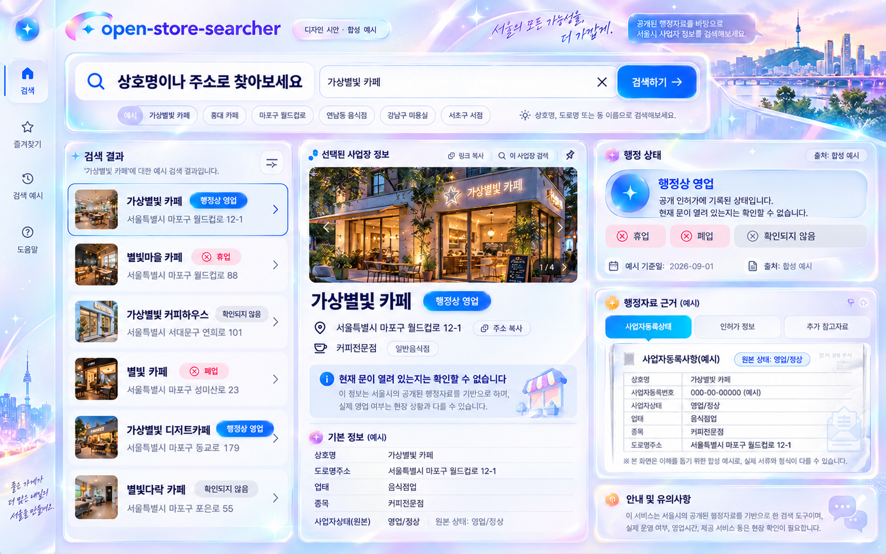

<!--
Purpose:        Specify the selected Prism Glass dashboard before implementation
Owner:          Architect / Planner / Reviewer
Update Trigger: When the selected composition, behavior, motion or acceptance criteria change
Harness Version: 1.1
-->

# Prism Glass Dashboard Design

Date: 2026-10-22
Status: Detailed design approved by the user on 2026-10-22 after TASK-027 execution intake.
Scope: Approved design basis for the implementation plan. No implementation, release or deployment acceptance.

## 1. Intent and authority

Replace the incumbent muted, vertically stacked dashboard with a bright, pearlescent,
multi-panel search workspace. The user selected concept 01 after requesting sparkling light
colors, multiple panels and a dynamic rather than static feeling.

The job remains checking a Seoul business's administrative record by name or address and
understanding its evidence and uncertainty. The visitor operates a search tool; ornament must
support scanning rather than turn the product into a promotional page.

Selected visual reference:



- Reference size: 1586 × 992 pixels.
- SHA-256: `07af42b40180795bea425e44f8e807c2a24a37d50795e298045ccd17f4de4c15`.
- [Generation provenance](../../../reports/design-prototypes/2026-10-22/README.md).
- [Targeted text corrections](../../../reports/design-prototypes/2026-10-22/revisions.md).
- The image governs palette, luminous materials, panel hierarchy and overall density.
  This specification governs real content, functions, accessibility and responsive behavior.
- The initial selection approved the visual direction. The user's later detailed-design approval
  accepts the tokens, breakpoints, durations and selection rules below as the implementation basis.
- Read [AGENTS.md](../../../AGENTS.md), [standards.md](../../../standards.md) and
  [PRD traceability](../../prd-traceability.md) first. The source PRD Sections 11 and 14 was
  inspected from the path recorded in [project memory](../../../memory/project.md).
  Accepted ADR-015 and ADR-016 in [decisions](../../../memory/decisions.md) control date meaning.

## 2. Scope: translate the image into the existing product

| Image element | Implementation decision |
|---|---|
| Pearlescent white, blue/lilac/cyan edge light, glass windows | Adopt as the replacement visual identity. |
| Search above results, business information and evidence | Adopt as the main information hierarchy. |
| Left navigation rail | Use labeled in-page anchors for search, results and usage guidance; no new route. |
| Large shop photograph and result thumbnails | Replace with an abstract prism/storefront illustration and typographic record identity. Current display data has no photo field; do not invent a business photograph. |
| Favorites, saved items, recent history, pinning | Exclude. Only the existing synthetic example input remains; no query/click persistence. |
| Registration number, representative name, official-looking certificate | Exclude. Render only current DisplayRecord fields and plain source evidence. |
| Share/copy-link action | Exclude; public share identifiers remain TASK-022. |
| Floating-window handles, dragging, resizing, collapsing | Decorative depth only; do not display a handle or control that has no function. |
| Multiple status chips beside one business | Render exactly one mapped status for that business. Any general legend is explicitly a legend. |
| Tabs and decorative action pills | Include only working existing actions. Required raw evidence and disclaimers must not be hidden behind a tab. |
| City skyline, glints and flowing light | Abstract local CSS/SVG decoration; no map, remote photo service, external fonts or runtime image generation. |
| External verification | Preserve the existing explicit Naver/Kakao click flow and its disclosure; no embedded map or automatic request. |

No dependency, service, source-delivery, status-mapping, public-URL, data-pipeline, Worker-protocol,
security-setting or infrastructure change is part of this design. No analytics, account flow,
history, global settings, generated business facts or new status inference is introduced.

## 3. Composition and reading order

### Desktop, at least 1280 CSS pixels

Use a full-width workspace with a 72px labeled rail, 24px content padding, 20px panel gaps and
a maximum workspace content width of 1600px. Keep the body as the vertical scroll container.

```text
┌────────┬─────────────────────────────────────────────────────────┐
│ Rail   │ Brand / purpose / truthful data context                  │
│        ├─────────────────────────────────────────────────────────┤
│ Search │ Luminous search command area + one example              │
│ Results├─────────────────────────────────────────────────────────┤
│ Guide  │ Load/retry state + submitted query + result announcement │
│        ├───────────────┬──────────────────────┬──────────────────┤
│        │ Candidate list│ Selected record      │ Raw status       │
│        │ Engine groups │ Name / mapped status │ Source / date    │
│        │ Addresses     │ Confidence / address │ Uncertainty      │
│        │ Row evidence  │ Category / lifecycle │ Existing links   │
│        │ Pagination    │                      │ Usage guidance   │
│        └───────────────┴──────────────────────┴──────────────────┤
│        │ Page-level source / disclaimer / privacy footer         │
└────────┴─────────────────────────────────────────────────────────┘
```

The results area has a 280–340px candidate column and a flexible selected-record article.
Inside that article, CSS positions basic/lifecycle information in the center and evidence
in a 280px right column; the central content must retain at least 320px. The visual separation
does not create a detached evidence record or a second state owner.

Use different panel heights and deliberate layering in decoration. Real text panels remain
upright, never rotated, overlapped or clipped. Avoid filling the opening viewport with a
large title; search and the workspace carry the visual identity. Target a 28–34px brand
heading, a 24–28px search heading and 24–28px selected business name.

### 1024–1279 CSS pixels

Use a 64px rail, 20px padding and 16px gaps. Render a 280px candidate column beside one
selected-record column. Place its evidence below its basic identity and above lifecycle
details. No right rail and no drawer are needed.

### Below 1024 CSS pixels

Move the navigation into normal document flow at the top. Use one column, 16px padding
(12px below 400px) and 16px gaps. The order is brand/context, search, load/result state,
candidate groups, selected record, page guidance/footer. A selected record's internal order
is identity/status/confidence, raw status/source/date/warnings, basic information, lifecycle
and external verification.

The full input and submit button stack when they cannot fit comfortably; example queries,
addresses and source URLs wrap. No fixed canvas height, horizontal page scroll, bottom
sheet, overlay, independent scroll pane or sticky search header. At 200% zoom and doubled
text, let CSS reflow naturally; do not preserve desktop columns by shrinking text.

### First-use and empty workspace

Before a submitted search, show search guidance in the candidate area, a bounded abstract
prism illustration in the detail area, and real dataset/date/source context in the evidence
area. There are no pretend result rows, invented totals or business status badges. The
existing synthetic demo is explicitly labeled at page and result levels.

## 4. Materials, typography and tokens

Glass is a surface treatment around readable information, not reduced text opacity.

| Token / role | Proposed value / use |
|---|---|
| Canvas | `#F5F8FF`; white foreground surfaces |
| Main ink | `#15234D`; body, headings and record values |
| Secondary ink | `#46577A`; labels and supporting copy |
| Primary action | `#2456E8` with white text; hover `#1B43BA` |
| Focus | `#1338B4`; 3px outline plus 3px white separation |
| Structural border | `#7384A8` for inputs and essential control boundaries |
| Decorative rim | White with cyan/lilac/pink gradient; not a control's only boundary |
| Operating | Text `#153FA6`, background `#E5F0FF` |
| Suspended | Text `#794315`, background `#FFF1D5` |
| Closed | Text `#91294F`, background `#FFE7F0` |
| Unverified | Text `#48546B`, background `#EEF1F7` |
| Decorative light | Cyan `#55DDF6`, lilac `#B8A0FF`, rose `#F5B9E7`; never body text |
| Corners | 24px primary glass surfaces, 16px inner groups, 12px controls, pill badges |
| Spacing | 4/8/12/16/20/24/32/48px scale |
| Surface shadow | Soft blue-tinted ambient shadow plus a thin white inset highlight |
| Typeface | Existing system stack; no external font request |
| Body / small labels | 16px / at least 14px; line height 1.6; no tiny evidence text |
| Control height | At least 44px, 48px for search input and primary submit |

Use an opaque white or at least 96%-white evidence surface; keep all essential text on a
white-equivalent surface. Larger decorative glass shells may use 86–92% white over the pastel
canvas. The proposed palette still needs rendered contrast verification: normal text at least
4.5:1, large text and meaningful UI boundaries at least 3:1 over the actual composited background.

Confine `backdrop-filter: blur(12px)` to at most two bounded decorative shells on wide screens.
Disable it below 1024px; the fallback is a solid light surface with the same border and shadow.
Do not blur text, use blend modes on evidence, animate blur, or stack full-viewport filters.
Forced colors mode uses system surfaces, visible borders and native focus; glints are hidden.

Decorative prism art is authored locally with CSS gradients and inline SVG, noninteractive,
`aria-hidden`, and `pointer-events: none`. One small abstract storefront/prism may occupy the
selected panel header, at most 160px high on desktop and 80px on mobile. It must not look like a
verified photograph or official certificate. No generated concept PNG ships as the live UI.

## 5. Information and candidate interaction

### Shared behavior

Keep `App`'s draft, dataset binding, submission sequence and loader request guards. Search
runs only on explicit form submit; the existing example fills the input without submitting.
Typing a new draft does not silently change the last valid submitted result or its context.
The new rail anchors do not change the URL with a query, ID or route contract; use local focus/
scroll actions if hash behavior would introduce a new public URL expectation.

Keep the search engine's ranking, Top-3 separation, confidence, `ambiguousTop`, counts,
exclusion warnings and 20-item similar-candidate pagination. Never sort by attractive status,
truncate the result set to the visual mock, or request the full compact dataset for presentation.

### Candidate summaries

Retain named lists for primary/other eligible candidates and similar candidates, in engine order.
A summary contains original name, address, category, mapped status, confidence, all four raw
operating/detail code/name values, the record's source, dataset date basis and applicable
uncertainty/staleness notice. Use compact labeled rows; missing fields retain their existing
fallbacks. Evidence is visible before selection, not only on hover.

Each summary has a native button labeled with record name, address and its result position
to inspect the full record. Use `aria-pressed` to identify the currently inspected candidate.
Do not make an entire article a button with nested source links, create a listbox, or add
roving arrow-key controls. Enhanced navigation remains TASK-023.

### Selection rules

- On a newly accepted search response, inspect `primaryMatch` only when it exists and the
  result is not ambiguous. Its heading identifies it as the engine's best match.
- Without a unique primary, show a neutral prompt to choose a candidate. Do not automatically
  choose the first similar or tied candidate.
- Clicking any candidate inspects that record only; it does not confirm identity, raise
  confidence, change its status or remove address-conflict/low-confidence warnings.
- Explicit selection focuses the selected-record heading, with `tabIndex=-1`, after rendering.
  A visible return-to-candidates button restores the exact invoking button when still present,
  otherwise the relevant list heading. This works identically with pointer and keyboard.
- A newly accepted submission, including the same query again, resets selection to the rule
  above. Dataset replacement clears old results and selection. Use the existing dataset and
  submission identity; never key inspection solely by an ID from an older dataset.
- Page loading keeps the last accepted list and inspected record with a visible busy state.
  On successful page change, keep inspection if the record is in persistent top matches or the
  new visible similar page; otherwise clear it. Focus the existing similar-candidate heading,
  announce the page range and expose the neutral inspection prompt. Do not fetch off-page
  records or silently pick a substitute.
- Failed search/page operations retain prior accepted inspection together with the prior
  submitted query/page context and an error. Late replies cannot overwrite newer accepted state.

Selected-record details contain both original addresses, category, all business-type fields,
four raw status fields, all eight lifecycle/source timestamp fields, source and dataset-date
context. Show missing values explicitly. The evidence side panel belongs to this same selected
article and is rendered from the same `CandidateMatch<DisplayRecord>` and `Coverage` props.
Do not duplicate mutable status or date state across panels.

## 6. Evidence, date and recovery invariants

Keep `mapLicenseStatusV1`, `EvidenceContext`, `SourceLink`, `CoverageClock` and `MapLinks`
as the existing policy owners. Presentation must never infer classification or source freshness.

- Display only `"행정상 영업"`, `"휴업"`, `"폐업"`, `"확인되지 않음"`.
  Status wording is text, accompanied by a distinct glyph; a sparkle means decoration only.
- Put mapped status, raw evidence, source, explicit date basis and disclaimer in the same
  record context. Keep the no-open-now notice near search and selected status.
- Synthetic: preserve `"합성 예시 데이터 · 실제 사업체 조회가 아닙니다"` and the exact
  `"예시 데이터 기준일"` label. No synthetic external map links.
- Verified: use the existing reviewed coverage date and `"데이터 기준일"` label.
- Collected: use `"데이터 수집일"` and preserve the existing message:
  `"원천 데이터 기준일은 확인되지 않았습니다. 수집일은 사업체 상태가 확인된 날짜가 아닙니다."`
- Unavailable or rejected date: show `"확인되지 않음"`, never a current-date substitute.
- Preserve warnings at age >= 7 Seoul calendar days, updated at Seoul midnight and on
  focus/visibility. Browser load time remains separately labeled; retry never resets age.
- Keep unknown raw values, no-result safety text, low-confidence guidance and ambiguous
  candidate guidance visible. These are normal evidence states, not reasons to paint a
  candidate closed or to disable inspection.
- Initial load failure shows retry, refresh guidance and the existing repository issue link.
  Failed refresh preserves previous good data/results/inspection where search remains usable.
  Successful replacement invalidates old result/evidence associations.
- Source and external-map URLs keep existing validation, `no-referrer`, and new-tab protections.
  No prefetch, thumbnail request, automatic map visit or query-derived external resource.
- Do not render user input as HTML or persist/transmit query, selection, click or location data.
  Ephemeral component state used to render the current view is not a history feature.

## 7. Motion contract

Dynamic character comes from depth and direct feedback; essential information never waits for
a decorative entrance. Use CSS and existing Preact state; no animation library or perpetual loop.

| Trigger | Normal motion | Reduced motion / fallback |
|---|---|---|
| Initial paint | A single rim highlight crosses decorative chrome in 650ms; text is fully visible from first paint | Static rim |
| Pointer hover | Fine-pointer devices only: surface rises up to 2px over 140ms; shadow changes without moving its neighbors | Static surface; color/border feedback remains |
| Candidate activation | Active border changes in 120ms; new detail glint lasts 220ms on a decorative overlay | Immediate active border and detail swap |
| Search button press | Up to 1px press offset over 80ms; no bounce | Immediate press state |
| Accepted search/page | Existing live-region announcement; a 180ms decorative underline sweep | Immediate update and announcement |
| Loading | Static truthful loading text with `aria-busy`; no fake percent or animated result rows | Same |
| Errors/stale warnings | Immediate stable presentation; never flash, auto-dismiss or pulse | Same |

Animation uses transform/opacity on decorative layers only. No delayed content opacity,
layout animation, per-result stagger, typing effect, moving evidence, continuous shimmer,
cursor trail, particles, parallax or animation on focus. Disable all spatial/sheen motion
under `prefers-reduced-motion: reduce`; no smooth scrolling is required. CSS disablement
does not affect visibility, search, focus or disclosure. Returning to a backgrounded tab
does not replay entrance effects or animate every clock update.

## 8. Implementation boundaries and sequence

This is a proposed implementation sequence, not an execution authorization or a claim that
the design has been built. Activate only one bounded task when implementation is requested.
Use the existing npm package and Preact local state.

| File / boundary | Proposed responsibility |
|---|---|
| `src/app/app.css` | Tokens, glass surfaces, workspace grid, responsive order, motion and fallbacks. |
| `src/app/app.tsx` | Page/rail/search/workspace composition; preserve loader, dataset, submission and request guards. |
| `src/app/search-form.tsx` | Existing controlled search, label/help/error/example behavior with new visual treatment. |
| `src/app/search-results.tsx` | Own transient inspection state alongside existing pagination; derive visible candidates without re-ranking. |
| New `src/app/candidate-summary.tsx` | Read-only compact evidence and explicit inspect button; consume a match and coverage. |
| `src/app/result-card.tsx` | Keep a complete semantic selected-record article; add an optional workspace layout and focusable heading while preserving default full-card behavior. |
| New `src/app/record-evidence.tsx` | Extract shared read-only raw-status/source/date/disclaimer rendering used by summaries and full details; one data input, no independent state. |
| Existing evidence/map/clock/loader/Worker modules | Reuse unchanged policies and interfaces; only DOM/class integration where required. |
| Existing component and E2E test files | Adapt structural expectations only where the approved workspace replaces full-card-per-row rendering; retain safety assertions. |
| New `src/app/workspace.test.tsx` | Pin selected candidate, focus return, page/dataset invalidation and stale-reply behavior. |

1. Reuse an appropriate existing checkout under current consent rules; preserve the original
   checkout's untracked duplicate files. Do not modify main directly through a commit.
2. Establish tokens, responsive shell and the first viewport against the selected reference.
   Review at the reference dimensions before expanding details; do not substitute another style.
3. Add the explicit inspect interaction, shared evidence and full-record layout. Pin behavioral
   changes with focused regressions before implementation; preserve both local and Worker paths.
4. Integrate all loading/error/uncertainty states, reduced motion, opaque/forced-color fallbacks
   and real keyboard/zoom behavior. Produce valid desktop/mobile screenshots.
5. Run required verification and independent review. Record differences from the reference
   (especially excluded photos and controls), measurements and any platform limitation.

A later approved implementation plan defines exact new internal prop signatures and test steps.
Do not rewrite pipeline/search modules or modernize unrelated files to implement this design.

## 9. Acceptance and verification matrix

All criteria below are prospective. Historical green tests do not verify this redesign.

| ID | Acceptance criterion | Requirement / verification |
|---|---|---|
| PG-01 | Light pearl/cyan/lilac composition, luminous blue search and clearly separate result/detail/evidence panels resemble the selected reference at 1586×992 | Visual review against reference; saved first-viewport and full-page captures |
| PG-02 | Name/address input, Enter, one example, validation and submitted-query context retain existing behavior | FR-01/02; component and four-browser search tests |
| PG-03 | Ranking, Top-3, conflicts and ties remain engine-owned; inspection never changes identity confidence or status | FR-03/07; workspace tests with unique, tied and similar-only fixtures |
| PG-04 | Every summary and selected record preserve four-state mapping, raw quartet, correct source/date/disclaimer and missing-value behavior | FR-04/05/06/08/09; all-status and missing-field component/E2E fixtures |
| PG-05 | All eight lifecycle/source fields and all business types remain accessible in selected details | FR-06; complete/missing/repeated-business-type fixtures |
| PG-06 | Collection/source/browser-load dates stay distinct; 6/7/8-day and Seoul-midnight/focus transitions remain correct | FR-08/14; existing evidence/clock regressions on page, summary and detail |
| PG-07 | Initial error, retry, rejected refresh, page/search error and delayed reply preserve the correct old state and never mix datasets | FR-07/13; injected loaders and deferred Worker replies |
| PG-08 | Similar pages remain 20 items, counts/ranges/order/positions preserved, every candidate reachable and selection reset rules deterministic | FR-03/11; 0/1/20/21/47 and large-result pagination tests on both search paths |
| PG-09 | 320/390/768/1024/1280/1586px widths, doubled text and 200% zoom have no page overflow, clipped evidence or obscured focus | FR-11; desktop/mobile screenshots and manual zoom/long-text inspection |
| PG-10 | Every action is keyboard reachable; selecting and returning restore meaningful focus; repeat search/page changes announce without decorative noise | Accessibility NFR / baseline FR-16; forward/reverse keyboard, E2E and manual AT observations |
| PG-11 | Zero axe violations for initial, selected, tied, empty and failure states; contrast passes on composited surfaces; meaningful states use text | Accessibility NFR; existing axe harness plus manual contrast/forced-color inspection |
| PG-12 | Reduced motion removes spatial/sheening effects; no-blur and forced-color views retain controls/evidence; content is present before and during animation | Accessibility NFR; emulated media, keyboard and screenshots |
| PG-13 | No new query/history/storage/network behavior; source/map links preserve explicit click boundary; no images/fonts downloaded from third parties | FR-02/10/12; existing privacy sentinels, resource audit and synthetic-map absence |
| PG-14 | First-content/LCP target 2.5s; loaded-search and page display 500ms; uncompressed initial code <=300,000 bytes; no motion-induced layout shift | Performance NFR; existing performance tools plus new workspace capture |
| PG-15 | Pinned full suite and independent review pass; existing production, calibration and publication gates are not reclassified | `npm run verify:full`, `npm run performance:check`, scoped reports and Reviewer verdict |

Performance acceptance measures search completion and usable painted results immediately; the
finite decorative sweep is not an excuse to defer visibility. Compare current and redesigned
views under the same fixture/profile. Reuse existing production-size measurements where available
and report unavailable physical/hosted performance honestly. A demo pass does not clear release.

Implementation verification uses project Node.js 24.19.0/npm 11.17.0 on the approved runner.
Do not add packages to obtain these versions or weaken tests because of a local platform gap.
Run the focused component/search/accessibility checks while developing, then required
`npm run verify:full` and `npm run performance:check` once the final implementation is stable.
Manual review additionally covers long names/addresses/raw statuses, unknown/future dates,
slow refresh, keyboard focus, 200% zoom, reduced motion and forced colors.

## 10. Delivery and approval disposition

Deliver this specification, the selected-image reference, a bounded backlog record and a
design-readiness review. The English-only harness policy applies; exact Korean strings above
are quoted product literals. No human handbook or milestone closure is required for this
design-only pass.

The user approved this concrete design on 2026-10-22 after TASK-027 execution intake and
requested continuation. TASK-027 already owns the sole active slot after PR #36. The next
artifact is the [implementation plan](../plans/2026-10-22-task-027-prism-glass.md), which requires
review and execution-method confirmation before product edits. Earlier proposed/design-only
wording describes the original design delivery; this dated approval supersedes its pending
detailed-design gate. No incidental excluded image feature, deployment, existing quality or
performance gate is approved by this design acceptance.
